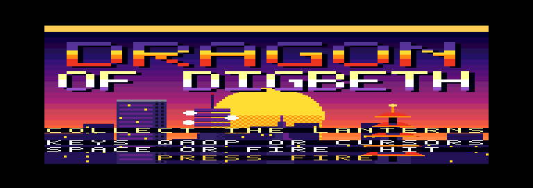
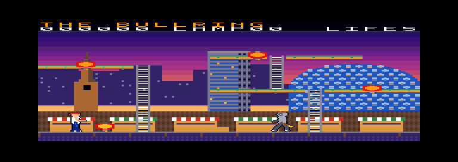
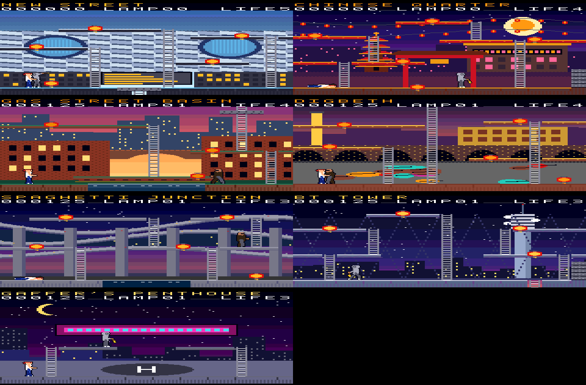

# Dragon of Digbeth

An original flip-screen martial-arts platformer for the **Amstrad CPC Plus / GX4000**, inspired by the classic 8-bit lantern-collecting games and set in Birmingham, UK.




## Play

Load `dist/dragon_of_digbeth.cpr` as a cartridge in a CPC Plus emulator (e.g. MAME `cpc6128p` / `gx4000`, or WinApe / Caprice32 with Plus mode).

```
mame cpc6128p -cart dist/dragon_of_digbeth.cpr
# or WinApe 2.0b2 (Plus mode): set Cartridge= in WinAPE.ini to this .cpr
```

| Action | Keys |
| --- | --- |
| Move / climb | Cursors or Q A O P, joystick |
| Jump | Up (away from a ladder), Up + Left/Right for a long jump |
| Punch | Fire / Space |
| Kick | Fire + Left/Right |
| Flying kick | Fire while jumping |

Collect the lanterns in each area. Collecting enough opens the shutters and hatches that lead to new parts of the city. Hoodies and Bouncers will keep coming. Knock them down with punches and kicks. Beat the Gaffer in his penthouse to win.

## Areas

The Bullring, New Street, Chinese Quarter, Gas Street Basin, Digbeth, Spaghetti Junction, BT Tower and the Gaffer's Penthouse.



## CPC Plus features used

- 12-bit (4096-colour) palettes for each room
- ASIC hardware sprites for the hero, enemies and lantern sparks (each 32x32 character is made from four 16x16 sprites with its own 15-colour sprite palette)
- Programmable raster interrupts that change the sky colour every 8 lines to draw a gradient
- 128K cartridge banking. Room art is ZX0-compressed and unpacked into screen RAM.

## Build

Requires Python 3 + Pillow and the [RASM](https://github.com/EdouardBERGE/rasm) assembler on `PATH`.

```
./build.sh
```

- `tools/rooms.py`: procedural room art and collision maps (with a reachability check for every lantern)
- `tools/chars.py`: procedural sprite art for the original characters
- `tools/build_assets.py`: converts everything to CPC Mode 0 data and emits `build/*.asm`
- `src/main.asm`: the Z80 game engine
- `src/dzx0_standard.asm`: the ZX0 decompressor by Einar Saukas & Urusergi (from the RASM distribution)
